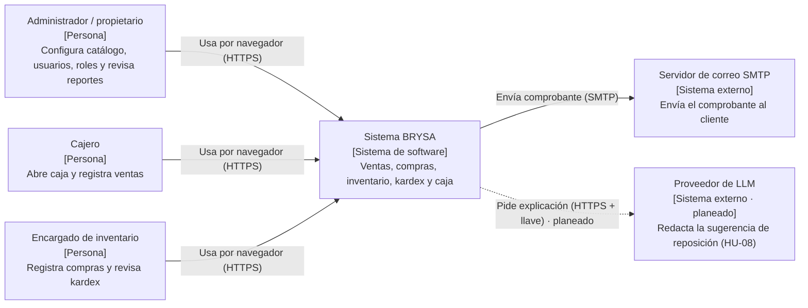
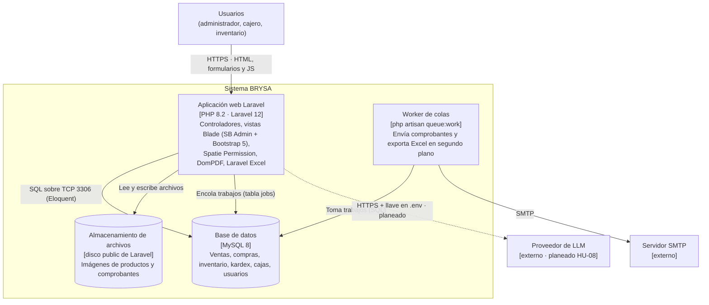
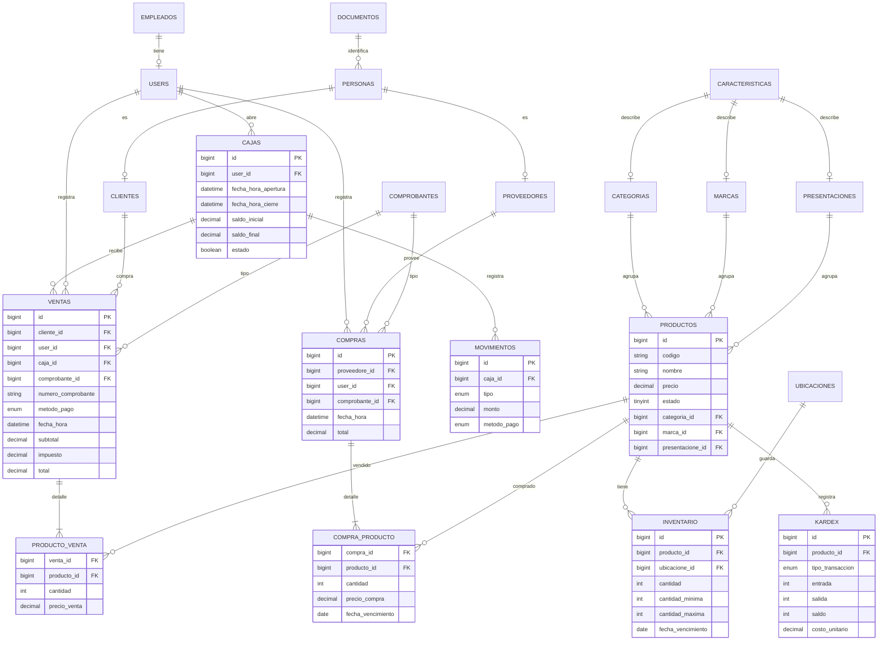
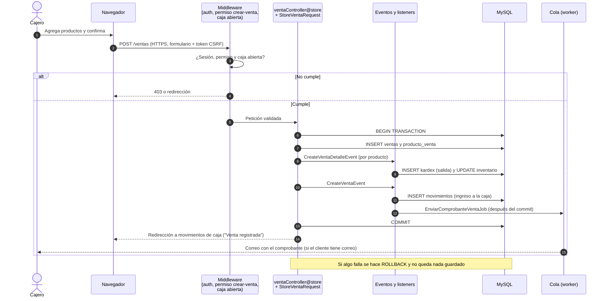
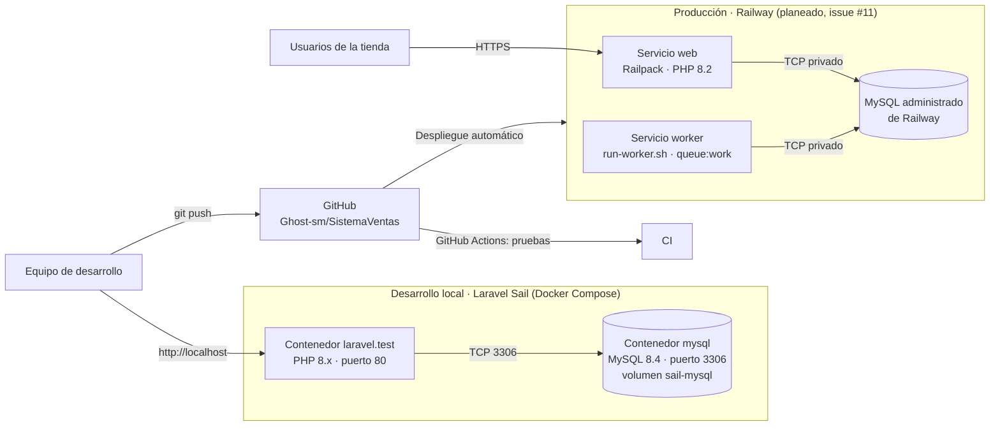

# Arquitectura – BRYSA: sistema web de ventas e inventario

**Proyecto integrador · Módulo 6 · Sesión 2**
Autores: Carol Dahiana González Ceballos y Santiago Mejía Londoño · 14 de noviembre de 2026

Este documento describe la arquitectura **tal como está hoy en el código** del repositorio. Lo que todavía no existe se marca como *planeado* y se enlaza con su issue.

Decisiones de arquitectura: 

- [ADR-001: Laravel 12 con PHP 8.2 como stack](adr/ADR-001-stack-laravel.md)
- [ADR-002: MySQL como base de datos](adr/ADR-002-base-de-datos-mysql.md)

## 1. Diagrama de contexto (C4 nivel 1)

Quién usa el sistema y con qué sistemas externos habla.

## 2. Diagrama de contenedores (C4 nivel 2)

Las piezas que se despliegan. El sistema es un **monolito MVC**: el mismo Laravel atiende las pantallas y la lógica de negocio. No hay una API REST separada (`routes/api.php` solo tiene la ruta por defecto `/user`).

| Contenedor | Tecnología | Responsabilidad |
|---|---|---|
| Aplicación web | PHP 8.2, Laravel 12, Blade, Bootstrap 5 | Pantallas, validación (Form Requests), reglas de negocio, roles y permisos |
| Worker de colas | `php artisan queue:work` (`run-worker.sh`) | Trabajos `EnviarComprobanteVentaJob` y `DownloadExcelVentasAllJob` |
| Base de datos | MySQL 8 | Persistencia transaccional de todas las operaciones |
| Archivos | Disco `public` de Laravel | Imágenes de productos y empleados, comprobantes de compra |

## 3. Modelo de datos

Tablas principales de las migraciones (`database/migrations`). Se omiten las tablas técnicas de Laravel (sesiones, tokens, jobs) y las de Spatie Permission (roles y permisos).

## 4. Flujo de una petición: registrar una venta (HU-03)

Lo que pasa en el código cuando el cajero confirma una venta (`ventaController@store`, eventos en `EventServiceProvider`).

## 5. Despliegue

**Hoy:** el sistema corre en local con Laravel Sail (Docker Compose: `compose.yaml`).
**Meta (issue #11):** URL pública en Railway. El repositorio ya tiene `railpack.json` (PHP 8.2) y ramas `railway/fix-deploy-*`, pero el último despliegue registrado en GitHub falló.

| Ambiente | Dónde | Variables sensibles |
|---|---|---|
| Local | Docker Compose (Sail) | `.env` local, fuera del repositorio |
| Producción (planeado) | Railway | Variables del servicio en Railway (`APP_KEY`, `DB_*`, `MAIL_*`, llave del LLM) |

## 6. Correcciones frente a la IA

Los diagramas se generaron con un asistente de IA a partir de los documentos del proyecto (informe de arquitectura del Módulo 2, informe del MVP del Módulo 3, documento de despliegue y README) y luego se compararon con el código del repositorio. Lo que no coincidía se corrigió así:

1. **API REST:** los documentos anteriores y el README describen una API REST de ventas con Sanctum. En el código no existe (`routes/api.php` solo tiene `/user`). Se dibujó como monolito MVC.
2. **Servicio de analítica en Python y LLM:** venían de la propuesta del Módulo 2, pero no están en el repositorio. Se dejaron solo como *planeado* (HU-08, issue #10) con línea punteada.
3. **Servidor Node.js:** el documento de despliegue anterior hablaba de un servidor Node.js. El backend es PHP/Laravel; Node solo se usa para Vite al desarrollar.
4. **Correo y colas:** no aparecían en los diagramas anteriores, pero existen en el código (`EnviarComprobanteVentaJob`, `run-worker.sh`), así que se agregaron el worker y el servidor SMTP.
5. **Fiados y devoluciones:** estaban en la formulación del proyecto, pero no hay tablas para ellos; no aparecen en el modelo de datos.
