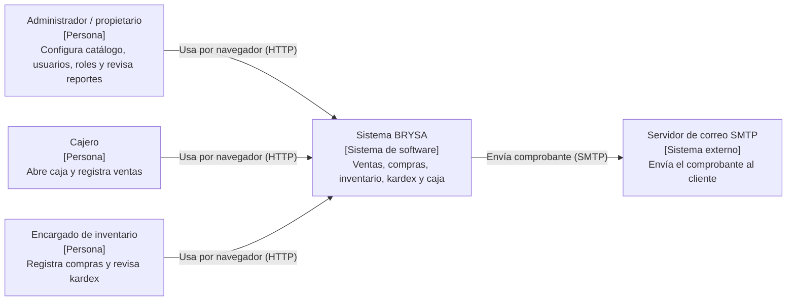
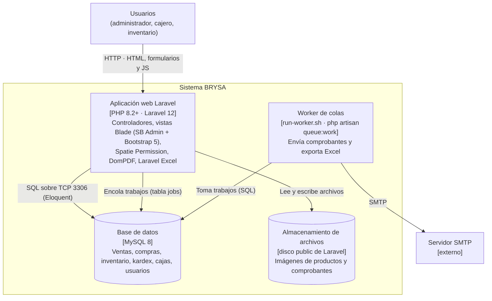
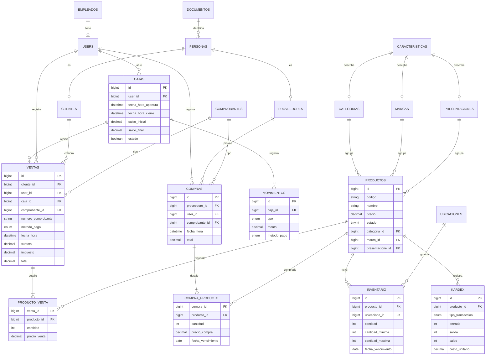
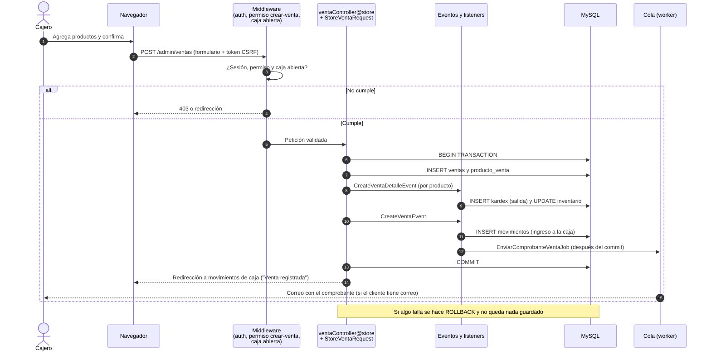
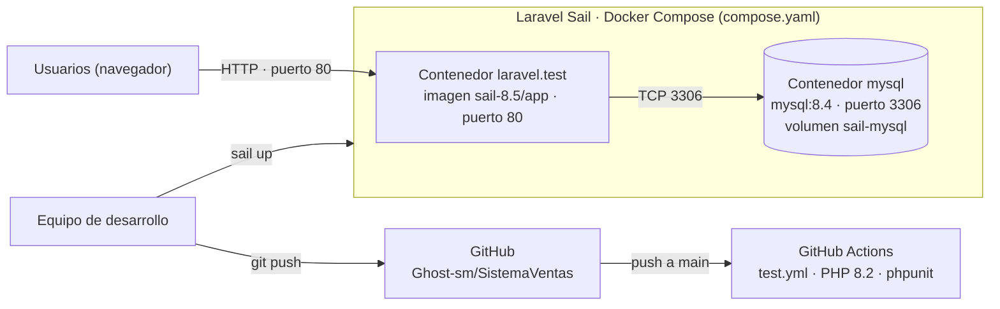

# Arquitectura – BRYSA: sistema web de ventas e inventario

**Proyecto integrador · Módulo 6 · Sesión 2**
Autores: Carol Dahiana González Ceballos y Santiago Mejía Londoño · 14 de noviembre de 2026

Este documento describe la arquitectura **tal como está hoy en el código** del repositorio: cada elemento de los diagramas corresponde a un archivo, una dependencia o una configuración que existe en el proyecto.

Decisiones de arquitectura:

- [ADR-001: Laravel 12 con PHP 8.2 como stack](adr/ADR-001-stack-laravel.md)
- [ADR-002: MySQL como base de datos](adr/ADR-002-base-de-datos-mysql.md)

## 1. Diagrama de contexto (C4 nivel 1)

Quién usa el sistema y con qué sistemas externos habla.

## 2. Diagrama de contenedores (C4 nivel 2)

Las piezas que se despliegan. El sistema es un **monolito MVC**: el mismo Laravel atiende las pantallas y la lógica de negocio. No hay una API REST separada (`routes/api.php` solo tiene la ruta por defecto `/user`).

| Contenedor | Tecnología | Responsabilidad |
|---|---|---|
| Aplicación web | PHP 8.2, Laravel 12, Blade, Bootstrap 5 | Pantallas, validación (Form Requests), reglas de negocio, roles y permisos |
| Worker de colas | `php artisan queue:work` (`run-worker.sh`) | Trabajos `EnviarComprobanteVentaJob` y `DownloadExcelVentasAllJob`. Con `QUEUE_CONNECTION=sync` (valor de `.env.example`) se ejecutan en el mismo proceso web |
| Base de datos | MySQL 8 | Persistencia transaccional de todas las operaciones |
| Archivos | Disco `public` de Laravel | Imágenes de productos y empleados, comprobantes de compra |

## 3. Modelo de datos

Tablas principales de las migraciones (`database/migrations`). Se omiten las tablas técnicas de Laravel (sesiones, tokens, jobs) y las de Spatie Permission (roles y permisos).

## 4. Flujo de una petición: registrar una venta (HU-03)

Lo que pasa en el código cuando el cajero confirma una venta (`ventaController@store`, eventos en `EventServiceProvider`).

## 5. Despliegue

El proyecto se ejecuta con **Laravel Sail** (Docker Compose, archivo `compose.yaml`): un contenedor para la aplicación y otro para MySQL. Cada push a `main` ejecuta las pruebas en **GitHub Actions** (`.github/workflows/test.yml`).

| Pieza | Archivo en el repositorio | Variables sensibles |
|---|---|---|
| Aplicación y base de datos | `compose.yaml` | `.env` local, fuera del repositorio (`APP_KEY`, `DB_*`, `MAIL_*`) |
| Pruebas automáticas | `.github/workflows/test.yml` | Ninguna; usa `.env.example` |
